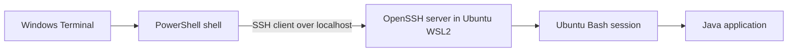

# Terminal Quest — From Windows to Linux

*A hands-on journey through terminals, shells, Linux, SSH, and developer automation.*

This repository is a local homework project for Java students who know basic Java but are new to terminal work. Students use a ready-made Java 21 HTTP app to learn the tools around an application: shells, files, processes, logs, WSL2, SSH, file transfer, and automation. They do not need to edit Java code.

## What you will learn

- Tell a terminal application, shell, and CLI program apart.
- Use PowerShell, basic CMD, and Ubuntu Bash in WSL2.
- Navigate files, inspect processes, use environment variables, and read logs.
- Connect from Windows to WSL2 using local SSH and copy files with SCP.
- Build, run, and deploy a Java JAR, then write scripts to repeat the workflow.

## Requirements

A Windows 10/11 computer with WSL2 support; Windows Terminal and PowerShell; Ubuntu in WSL2; Git; and a Java 21 JDK on Windows and Ubuntu. The included Gradle Wrapper downloads Gradle on first use, so a separate Gradle installation is unnecessary. Initial installation of Ubuntu, JDK packages, and Gradle needs internet access and may need administrator or `sudo` rights. The exercises themselves use only your computer. No cloud account, Docker, or IDE is required.

Check with `java -version`, `git --version`, and `wsl --status` in PowerShell. Follow [Windows setup](01-windows/README.md) and [Linux setup](02-linux/README.md) before the SSH exercise.

## Learning path

| Section | Work | Assignment |
|---|---|---|
| [01 Windows](01-windows/README.md) | Windows Terminal, PowerShell, CMD, files, processes | [TODO](01-windows/TODO.md) |
| [02 Linux](02-linux/README.md) | Ubuntu WSL2, Bash, paths, permissions, packages | [TODO](02-linux/TODO.md) |
| [03 Integration](03-integration/README.md) | Local SSH, SCP, remote Java deployment | [TODO](03-integration/TODO.md) |

Start with the [overall checklist](STUDENT_TODO.md). Read the [concept guides](docs/01-terminal-vs-shell-vs-cli.md) and keep the [command cheatsheet](docs/command-cheatsheet.md) nearby. Record your work in the [report template](submission/REPORT_TEMPLATE.md).

## How the pieces interact

These are separate programs and environments. Windows Terminal displays the PowerShell session; the PowerShell `ssh` program contacts an SSH server in WSL2; Ubuntu runs the Java process. WSL2 is a Linux environment on your Windows computer, not a public server.

## Sample application

The [sample app](sample-app/build.gradle) is a small standard Java HTTP server. Its packages separate configuration, HTTP handling, business responses, and logging. From PowerShell inside `sample-app`, run `./gradlew.bat clean test jar`; from Bash run `./gradlew clean test jar`. On Windows PowerShell, `java -jar build/libs/terminal-quest-app.jar` starts it. On Bash, use the same `java -jar` command. Visit `http://127.0.0.1:8080/health`, `/hello`, and `/info`. Stop a foreground run with Ctrl+C. The default port is 8080; `APP_NAME`, `SERVER_PORT`, and `LOG_LEVEL` can change it. Invalid settings cause a clear startup error.

The server binds to `127.0.0.1` for local practice. If port 8080 is occupied, choose another port through `SERVER_PORT`. The artifact name is always `terminal-quest-app.jar`.

## Deliverables and final challenge

Submit your completed [PowerShell](scripts/windows) and [Bash](scripts/linux) scripts, command evidence, and [report](submission/REPORT_TEMPLATE.md). The final challenge is a PowerShell `deploy.ps1` that builds the app, copies the JAR to Ubuntu with SCP, starts it there using SSH, tests `/health`, and records enough information to stop it safely. Keep SSH local, protect your private key, and never commit credentials.

Teacher: review the TODOs and starter scripts before distributing. Students should work on a copy or fork; the repository contains no answer key. The sample app is complete so learners can concentrate on terminal operations. Windows/WSL2 steps require validation on a real Windows machine.
